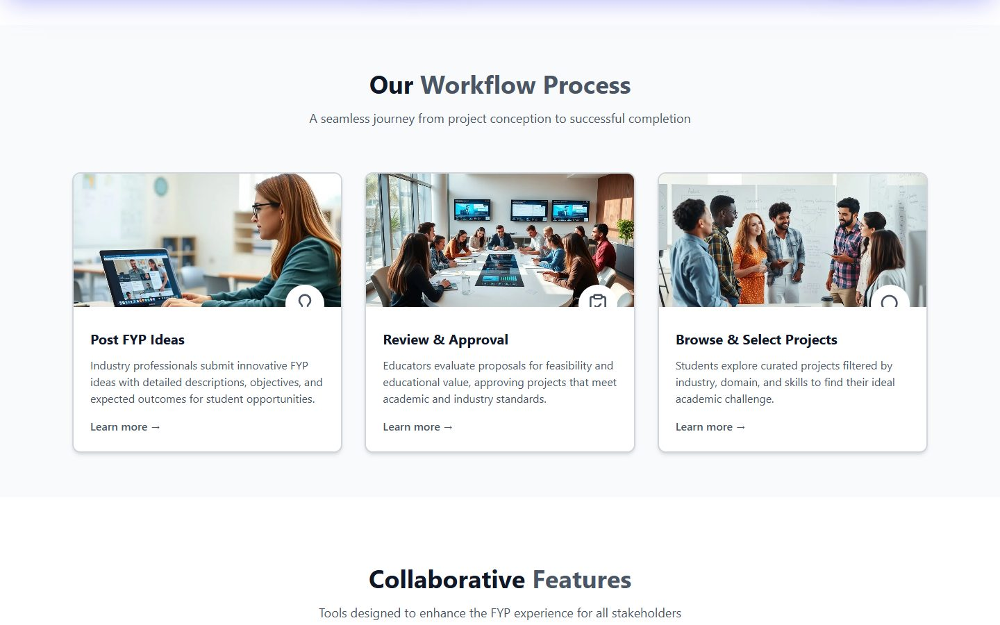
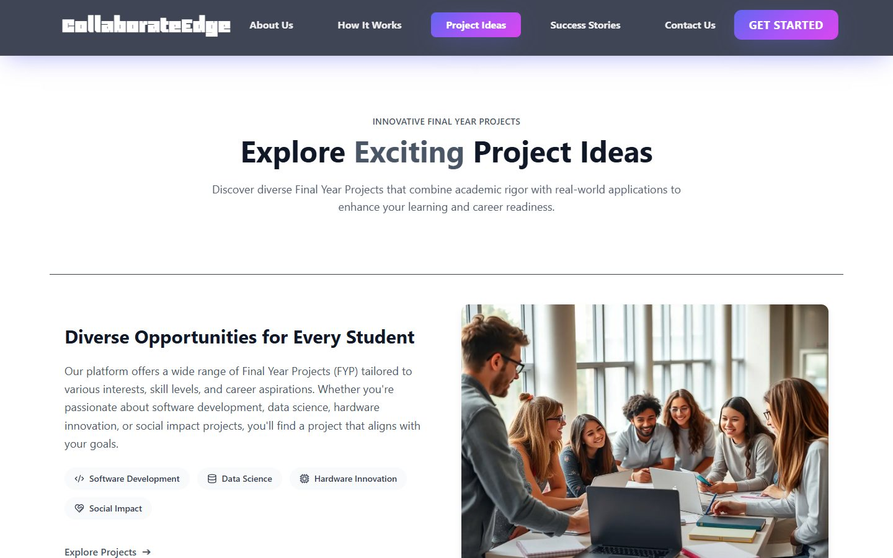

# Collaborative Edge

**A MERN web portal that connects industry, teachers and students around final-year projects (FYPs): industry posts project ideas, teachers approve and supervise them, and students pick a project, submit work and get evaluated.**

[](https://collaborative-edge.vercel.app)
[](https://github.com/Umair-Habibx123/collaborative-edge/actions/workflows/ci.yml)
[](LICENSE)

**Status:** my final-year project, presented at the final defence in May 2025. It's maintained, with security fixes made in 2026.

**[Open the live site](https://collaborative-edge.vercel.app)**


## How it works

1. **Industry representatives** post project ideas with required skills, team size, dates and attachments.
2. **Teachers** review each idea and approve or reject it, then apply to supervise approved projects.
3. **Students** browse approved projects, join or form a group, and submit deliverables.
4. **Teachers and industry** follow each group's progress and evaluate the work. Students then see their ratings and remarks.
5. **Admins** verify new accounts, manage users and projects, and edit the privacy policy.

Every role has its own dashboard with charts, notifications and profile settings. Each dashboard also has an AI assistant, powered by Google Gemini, that can read text and images.





## Quick start

You need **Node.js 20+** and a MongoDB database. A free [MongoDB Atlas](https://www.mongodb.com/atlas) cluster works.

```bash
git clone https://github.com/Umair-Habibx123/collaborative-edge.git
cd collaborative-edge
npm run install:all                           # installs root, backend and frontend
cp backend/.env.example backend/.env          # then fill in MONGO_URI, JWT_SECRET, etc.
cp frontend/.env.example frontend/.env
npm run dev
```

The web app opens at **http://localhost:5173**, and the API runs at **http://localhost:5000**.

To create the first admin account, set `ADMIN_EMAIL` and `ADMIN_PASSWORD` in `backend/.env` before the first start. The admin can then verify everyone who registers.

| Command | Where | What it does |
|---|---|---|
| `npm run dev` | root | Starts the API and the web app together |
| `npm run dev` | `backend/` or `frontend/` | Starts just that part |
| `npm run build` | `frontend/` | Builds the production site into `frontend/dist/` |
| `npm run lint` | `frontend/` | Checks the frontend code with ESLint |
| `npm run check` | `backend/` | Checks every backend file for syntax errors |

## How it's built

| Part | What it uses |
|---|---|
| Frontend | React 19, React Router, Tailwind CSS 4, Framer Motion, Chart.js, built with Vite |
| Backend | Node.js and Express 5, with a REST API under `/api` |
| Database and files | MongoDB with Mongoose; uploaded files stored in GridFS |
| Accounts | JWT in an HTTP-only cookie, bcrypt password hashing, role-based route guards |
| Email | Nodemailer, for sign-up verification codes, password resets and account approval |
| AI assistant | Google Gemini, called from the backend so the API key stays on the server |
| Hosting | Vercel (the frontend and the backend are separate projects) |

```
frontend/src/app/Modules/   one folder per role: Admin, Industry, Teacher, Student, plus login, sign-up, welcome pages and AI
frontend/src/auth/          signed-in user and protected routes
backend/routes/             API routes          backend/controllers/   chart and stats endpoints
backend/models/             Mongoose schemas    backend/middleware/    auth, rate limits, security headers
```

## Security

- **Server-side keys:** secrets such as the database URL, JWT secret, email password and Gemini key are read only by the backend. The frontend's `.env` holds only the public API address.
- **Hardened API:** Helmet sets security headers, `hpp` blocks parameter pollution, logins and the API are rate limited, and passwords are hashed with bcrypt.
- **Reporting:** if you find a vulnerability, please open a private report under **Security → Report a vulnerability** rather than a public issue.

## License

[MIT](LICENSE) © 2025 [Umair Habib](https://github.com/Umair-Habibx123)
